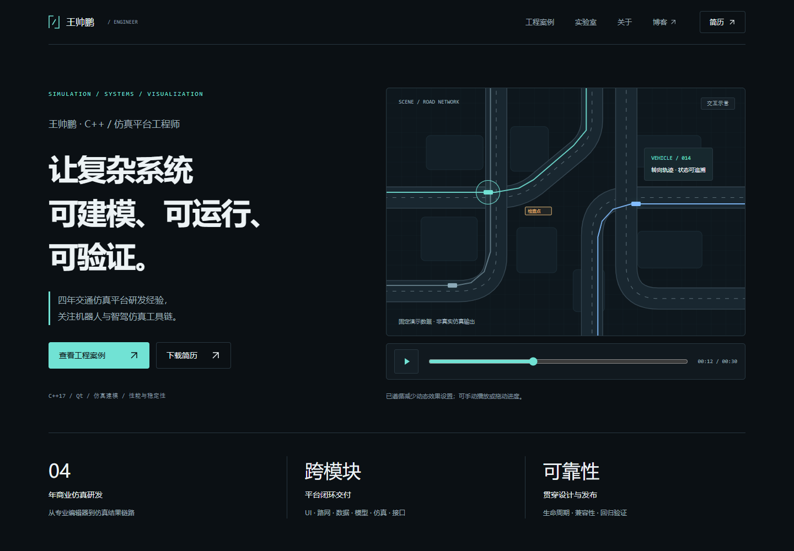
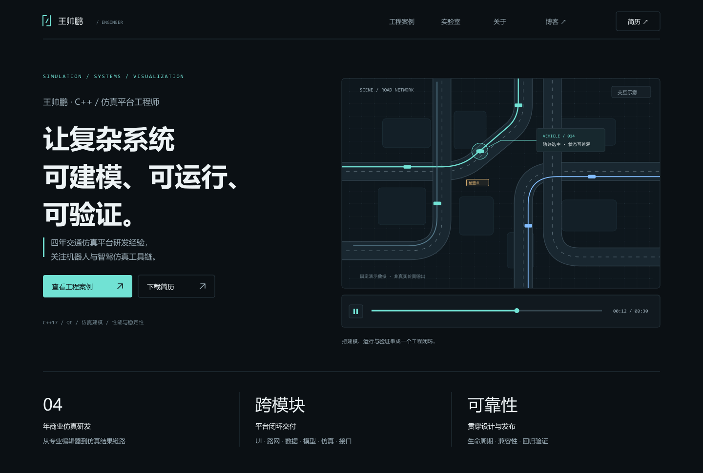

# 王帅鹏 · 仿真平台工程师个人网站

求职作品集、技术内容与个人实验室。面向机器人与智驾仿真岗位，以已有 C++/Qt 商业仿真平台经验为基础。

**当前：阶段二，在线审阅版本已部署并通过浏览器验证。** 已实现首页、三个工程案例、四个实验项目、关于、简历、PDF 下载与首屏轨迹交互。阶段一设计稿保留在 `design/`；线上实际截图在 `previews/online-*.png`，本地截图在 `previews/site-*.png`。

- GitHub：[STDwang/penpenWeb](https://github.com/STDwang/penpenWeb)；代码、文档和实际截图已提交。
- 在线预览：[https://stdwang.github.io/penpenWeb/](https://stdwang.github.io/penpenWeb/)（GitHub Pages，直接访问）
- WorkBuddy 镜像：[https://penpen-portfolio.app.workbuddy.host/portfolio/?sharecode=ZGOW7OHTCI](https://penpen-portfolio.app.workbuddy.host/portfolio/?sharecode=ZGOW7OHTCI)

## 本地运行

需要 Node.js 22 或更新版本。首次运行：

```powershell
cd code
npm ci
npm run dev
```

打开终端显示的 [http://127.0.0.1:3000](http://127.0.0.1:3000)。生产构建预览：

```powershell
npm run build
npm run start
```

## 实际页面截图



[线上桌面全页](previews/online-desktop.png) · [线上手机全页](previews/online-mobile.png) · [线上平板全页](previews/online-tablet.png)

以上截图来自实际访问的 Vercel 在线站点。页面默认暂停在 12/30 秒；浏览器检查中的全页截图启用了减少动态效果。[本地构建截图](previews/site-desktop.png)保留用于对照。

## 原始设计稿



- [桌面全页 PNG](previews/home-desktop.png) · [可编辑 SVG](design/mockups/home-desktop.svg)
- [手机全页 PNG](previews/home-mobile.png) · [可编辑 SVG](design/mockups/home-mobile.svg)
- [手机首屏](previews/home-mobile-hero.png)
- [信息架构](docs/02-information-architecture.md)
- [首页文案](docs/03-home-copy.md)
- [内容依据与项目清单](docs/04-content-evidence.md)
- [视觉与交互规范](design/visual-system.md)
- [审阅与验收记录](docs/05-review.md)

## 目录

| 目录 | 用途 |
| --- | --- |
| `code/` | Next.js 应用、统一项目内容、静态资源及浏览器测试 |
| `docs/` | 定位、信息架构、文案、内容依据、验收 |
| `design/` | 视觉规范、参考来源、原始项目截图、SVG 与导出工具 |
| `previews/` | 当前设计稿 PNG；阶段二增加真实页面截图 |
| `简历/` | 现有 DOCX/PDF；阶段三轻量修订 |
| `work/` | 本地文本提取与临时文件，不提交 |

## 设计稿再生成

`design/render-mockups.mjs` 是独立的设计导出工具，不是网站运行入口。需要 Node.js、Sharp 与 Microsoft YaHei 字体；该字体用于本机渲染，不分发字体文件。SVG 保留可编辑文字和向量示意，截图嵌入 SVG 以支持独立打开。

```powershell
# DESIGN_NODE_MODULES 指向已有且包含 sharp 的 node_modules 目录。
$env:DESIGN_NODE_MODULES = '你的 node_modules 绝对路径'
node design/render-mockups.mjs
node design/check-mockups.mjs
```

## 内容维护与验证

项目内容集中在 `code/src/content/projects.ts`。商业案例与个人项目共用内容结构，页面与详情路由在构建时生成。图片在 `code/public/images/`；公开 PDF 在 `code/public/resume/`。下载文件是原版简历的副本，本地 DOCX/PDF 源文件未修改。

```powershell
cd code
npm run typecheck
npm run build
# 先在另一终端 npm run start，再运行：
npm run test:e2e
```

浏览器检查使用本机 Microsoft Edge。其他系统可调整 `code/playwright.config.ts` 的 `channel`，或安装对应 Playwright Chromium 后移除该设置。已验证 1440px、768px、390px 三个尺寸的交互、路由、PDF、404、noindex 和无 JavaScript 降级。

验证在线站点时可以复用同一套检查，并将截图与本地结果分开保存：

```powershell
cd code
$env:PLAYWRIGHT_BASE_URL = 'https://penpen-portfolio.app.workbuddy.host/portfolio/?sharecode=ZGOW7OHTCI'
$env:SCREENSHOT_PREFIX = 'online'
# 如果本机需要已配置的代理，再设置 PLAYWRIGHT_PROXY；默认不使用代理。
npm run test:e2e
```

2026-10-21 线上三尺寸共 9 个浏览器用例通过，详情见[线上验收记录](docs/06-online-verification.md)。

## 网站技术与部署

Next.js App Router、React、TypeScript、Tailwind CSS；提交 npm 锁文件；本地内容预渲染，首屏 SVG 交互独立加载。只使用本地资源，不在访问时请求 GitHub/CSDN。静态信息无需 JavaScript 即可读取。

GitHub 仓库：[STDwang/penpenWeb](https://github.com/STDwang/penpenWeb)。当前采用静态导出托管：`next.config.ts` 设置 `output: "export"`、`basePath: "/portfolio"`、`trailingSlash: true`，`npm run build` 生成 `out/`，将导出产物放入托管目录的 `portfolio/` 子路径发布，入口跳转页指向 `/portfolio/`。

在线站点托管在 WorkBuddy（[在线预览](https://penpen-portfolio.app.workbuddy.host/portfolio/?sharecode=ZGOW7OHTCI)），公开页面、交互与下载已验证。此前阶段二审阅版本曾部署于 Vercel，现已切换为 WorkBuddy 静态托管。生产发布时把 `SITE_URL` 设置为已验证的正式 origin 并配置索引开关；当前在线站点保持 `noindex, nofollow`，正式搜索收录在阶段三审阅后配置。

当前停在阶段二在线审阅节点；阶段三处理反馈、同步 DOCX/PDF，并确认正式域名与搜索收录设置。

## 来源

[素材与设计参考](design/references.md)。公开项目按许可证实际情况标注；公开代码不自动等同于取得开源许可。原始个人资料、公司代码、临时材料与认证配置不进入公开仓库。
