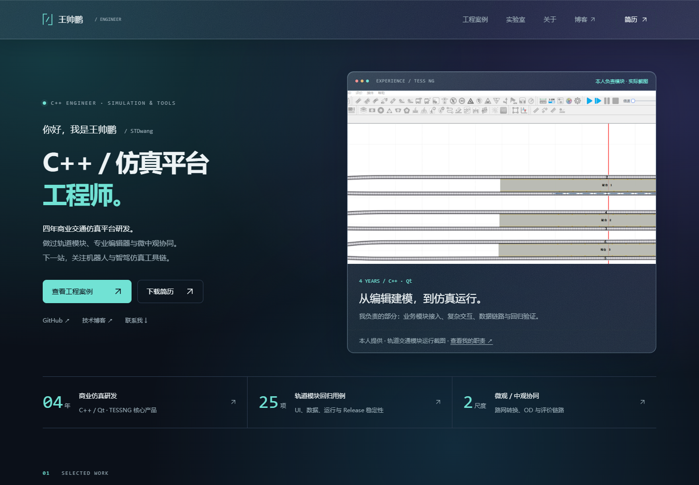
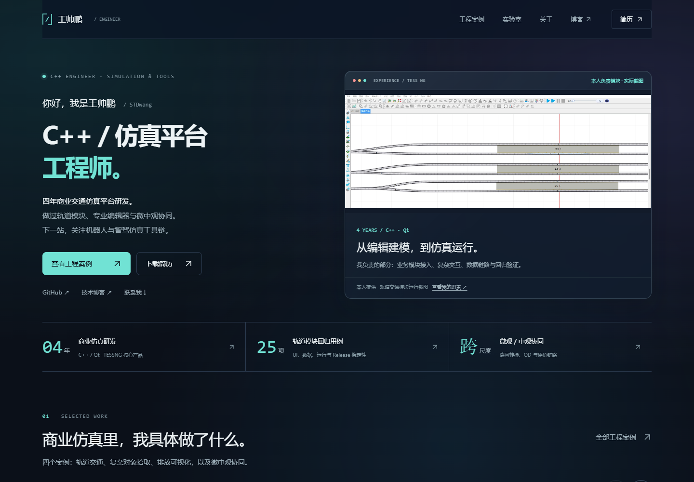
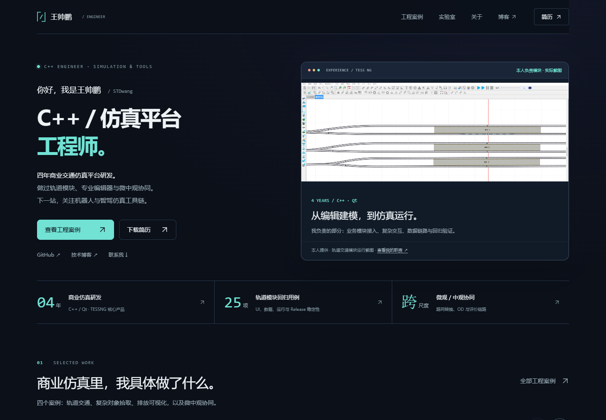
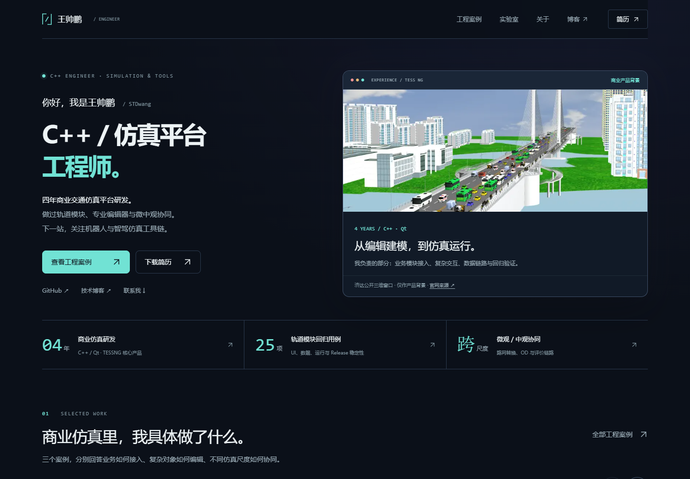

# 王帅鹏 · 仿真平台工程师个人网站

求职作品集、技术内容与个人实验室。面向机器人与智驾仿真岗位，以已有 C++/Qt 商业仿真平台经验为基础。

**当前：真实截图满帧 + 交互反馈补齐版（尚未发布）。** 商业截图按素材流水线重新裁切为满帧 16:9，首屏、卡片与详情页不再被补白稀释；`.text-link` 补上 hover 反馈，移动端菜单支持点击外部关闭与滚动锁定，画廊增加可视进度条，详情页目录跟随滚动高亮并支持站内大图查看。索引开关与托管平台解耦，设置 `SITE_URL` 后 canonical、分享卡片与 sitemap 指向生产域名。[本轮分析与计划](docs/10-ui-interaction-plan.md)。线上仍为上一版，WorkBuddy 镜像待同步。

- GitHub：[STDwang/penpenWeb](https://github.com/STDwang/penpenWeb)；代码、文档和实际截图已提交。
- 在线预览：[https://stdwang.github.io/penpenWeb/](https://stdwang.github.io/penpenWeb/)（GitHub Pages，直接访问）
- WorkBuddy 镜像：[https://penpen-portfolio.app.workbuddy.host/portfolio/?sharecode=ZGOW7OHTCI](https://penpen-portfolio.app.workbuddy.host/portfolio/?sharecode=ZGOW7OHTCI)

## 本地运行

需要 Node.js 22 或更新版本。首次运行：

```powershell
cd code
npm ci
npm run dev
```

默认打开 [http://127.0.0.1:3000/portfolio/](http://127.0.0.1:3000/portfolio/)。生产静态导出：

```powershell
npm run build
```

产物为 `code/out/`，托管时挂载到与 `NEXT_PUBLIC_BASE_PATH` 一致的子路径。静态导出不使用 `next start`。

## 实际页面截图

### 本轮本地审阅版（满帧截图与交互反馈，尚未发布）



[桌面全页](previews/polish-desktop.png) · [手机全页](previews/polish-mobile.png) · [平板全页](previews/polish-tablet.png) · [ImagePlayer 桌面详情](previews/polish-imageplayer-desktop.png) · [ImagePlayer 手机详情](previews/polish-imageplayer-mobile.png) · [ImagePlayer 平板详情](previews/polish-imageplayer-tablet.png)

本机实际浏览器渲染的本地生产产物。商业截图改为满帧 16:9，首屏、卡片与详情页不再被补白稀释；链接 hover、移动菜单、画廊进度条、详情目录高亮与站内大图查看已补齐。三尺寸 18 项浏览器检查通过，生产与预览两种索引模式各验证一轮。分析与计划见 [本轮文档](docs/10-ui-interaction-plan.md)。

### 当前 GitHub Pages 线上版本



[线上桌面全页](previews/released-pages-desktop.png) · [线上手机全页](previews/released-pages-mobile.png) · [线上平板全页](previews/released-pages-tablet.png) · [线上 ImagePlayer 详情](previews/released-pages-imageplayer-desktop.png)

来自 2026-10-22 实际访问的 GitHub Pages 部署，而非本地构建或设计稿。线上三尺寸 15 项浏览器检查通过；检查经本机已有代理，不代表大陆直连稳定性。WorkBuddy 镜像尚未同步；具体提交与检查范围见 [发布记录](docs/09-release.md)。

### 本轮本地审阅版


[桌面全页](previews/glass-desktop.png) · [手机全页](previews/glass-mobile.png) · [平板全页](previews/glass-tablet.png)

以上为本地生产静态产物的实际渲染，非概念图或线上截图。图片保持不透明，文字与截图可读性优先；滤镜不支持时使用实色降级。此前真实模块截图版保留如下。



[桌面全页](previews/modules-desktop.png) · [手机全页](previews/modules-mobile.png) · [平板全页](previews/modules-tablet.png) · [ImagePlayer 桌面详情](previews/modules-imageplayer-desktop.png) · [ImagePlayer 手机详情](previews/modules-imageplayer-mobile.png)

实际浏览器渲染，非线上截图。[排放与中观卡片](previews/modules-work-desktop.png)。素材已脱敏，商业截图保留产品水印；牙片按作者要求公开为网上示例，仅用于图像取反演示。ImagePlayer 本地 README 同步加入三张图、构建与使用说明。类型检查、17 页静态构建和三尺寸 15 项浏览器检查通过。[本轮对应关系与审阅记录](docs/08-module-screenshots.md)。

### 上一轮 UI 审阅版



[桌面全页](previews/refresh-desktop.png) · [手机首屏](previews/refresh-mobile-hero.png) · [手机全页](previews/refresh-mobile.png) · [平板全页](previews/refresh-tablet.png)

来源为本机实际浏览器渲染，不是设计稿或线上截图。横向卡片支持触摸、触控板、左右按钮和键盘 Home/End；未增加轮播依赖。参考取舍、素材来源、验证范围与审阅要点见 [本轮审阅记录](docs/07-ui-refresh.md)。

### 历史线上版本


[线上桌面全页](previews/online-desktop.png) · [线上手机全页](previews/online-mobile.png) · [线上平板全页](previews/online-tablet.png)

以上截图来自实际访问的 Vercel 在线站点。页面默认暂停在 12/30 秒；浏览器检查中的全页截图启用了减少动态效果。[本地构建截图](previews/site-desktop.png)保留用于对照。

## 原始设计稿


- [桌面全页 PNG](previews/home-desktop.png) · [可编辑 SVG](design/mockups/home-desktop.svg)
- [手机全页 PNG](previews/home-mobile.png) · [可编辑 SVG](design/mockups/home-mobile.svg)
- [手机首屏](previews/home-mobile-hero.png)
- [信息架构](docs/02-information-architecture.md)
- [首页文案](docs/03-home-copy.md)
- [内容依据与项目清单](docs/04-content-evidence.md)
- [视觉与交互规范](design/visual-system.md)
- [审阅与验收记录](docs/05-review.md)

## 目录

| 目录 | 用途 |
| --- | --- |
| `code/` | Next.js 应用、统一项目内容、静态资源及浏览器测试 |
| `docs/` | 定位、信息架构、文案、内容依据、验收 |
| `design/` | 视觉规范、参考来源、原始项目截图、SVG 与导出工具 |
| `previews/` | 当前设计稿 PNG；阶段二增加真实页面截图 |
| `简历/` | 现有 DOCX/PDF；阶段三轻量修订 |
| `work/` | 本地文本提取与临时文件，不提交 |

## 设计稿再生成

`design/render-mockups.mjs` 是独立的设计导出工具，不是网站运行入口。需要 Node.js、Sharp 与 Microsoft YaHei 字体；该字体用于本机渲染，不分发字体文件。SVG 保留可编辑文字和向量示意，截图嵌入 SVG 以支持独立打开。

```powershell
# DESIGN_NODE_MODULES 指向已有且包含 sharp 的 node_modules 目录。
$env:DESIGN_NODE_MODULES = '你的 node_modules 绝对路径'
node design/render-mockups.mjs
node design/check-mockups.mjs
```

## 内容维护与验证

项目内容集中在 `code/src/content/projects.ts`。商业案例与个人项目共用内容结构，页面与详情路由在构建时生成。新增/维护卡片的 `focus`（重点）、`outcome`（交付链路）、图片及来源字段即可同步列表与详情。图片在 `code/public/images/`；公开 PDF 在 `code/public/resume/`。下载文件是原版简历的副本，本地 DOCX/PDF 源文件未修改。

```powershell
cd code
npm run typecheck
npm run build
# 先在另一终端 npm run dev，再运行：
npm run test:e2e
```

浏览器检查使用本机 Microsoft Edge。其他系统可调整 `code/playwright.config.ts` 的 `channel`，或安装对应 Playwright Chromium 后移除该设置。已验证 1440px、768px、390px 三个尺寸的交互、路由、PDF、404、noindex 和无 JavaScript 降级。

验证在线站点时可以复用同一套检查，并将截图与本地结果分开保存：

```powershell
cd code
$env:PLAYWRIGHT_BASE_URL = 'https://stdwang.github.io'
$env:NEXT_PUBLIC_BASE_PATH = '/penpenWeb'
$env:SCREENSHOT_PREFIX = 'online'
# 如果本机需要已配置的代理，再设置 PLAYWRIGHT_PROXY；默认不使用代理。
npm run test:e2e
```

2026-10-21 线上三尺寸共 9 个浏览器用例通过，详情见[线上验收记录](docs/06-online-verification.md)。

## 网站技术与部署

Next.js App Router、React、TypeScript、Tailwind CSS；提交 npm 锁文件；本地内容预渲染，首屏 SVG 交互独立加载。只使用本地资源，不在访问时请求 GitHub/CSDN。静态信息无需 JavaScript 即可读取。

GitHub 仓库：[STDwang/penpenWeb](https://github.com/STDwang/penpenWeb)。当前采用静态导出托管：`next.config.ts` 设置 `output: "export"`，子路径由 `NEXT_PUBLIC_BASE_PATH` 环境变量控制，默认 `/portfolio`（WorkBuddy 托管）；GitHub Pages 构建时设为 `/penpenWeb`，产物推送 `gh-pages` 分支发布。

发布时同时设置 `SITE_URL`，否则站点保持 `noindex, nofollow`、canonical 与分享卡片会指向 localhost：

```powershell
cd code
$env:NEXT_PUBLIC_BASE_PATH = '/penpenWeb'
$env:SITE_URL = 'https://stdwang.github.io/penpenWeb'
npm run build
```

不带 `SITE_URL` 的本地与预览构建继续输出 `noindex, nofollow` 和空 sitemap。

在线站点：GitHub Pages 为主站（[在线预览](https://stdwang.github.io/penpenWeb/)），WorkBuddy 为镜像（[镜像链接](https://penpen-portfolio.app.workbuddy.host/portfolio/?sharecode=ZGOW7OHTCI)）。此前阶段二审阅版本曾部署于 Vercel，现已切换。当前在线站点保持 `noindex, nofollow`，正式搜索收录在阶段三审阅后配置。

在线站点托管在 WorkBuddy（[在线预览](https://penpen-portfolio.app.workbuddy.host/portfolio/?sharecode=ZGOW7OHTCI)），公开页面、交互与下载已验证。此前阶段二审阅版本曾部署于 Vercel，现已切换为 WorkBuddy 静态托管。生产发布时把 `SITE_URL` 设置为已验证的正式 origin 并配置索引开关；当前在线站点保持 `noindex, nofollow`，正式搜索收录在阶段三审阅后配置。

本轮同步 GitHub 源码和 Pages，WorkBuddy 镜像仍待通过已有应用重新发布。没有变更托管平台、索引开关或桌面简历；简历优化按要求安排在部署完成之后。精确发布状态见 [发布记录](docs/09-release.md)。

## 来源

[素材与设计参考](design/references.md)。公开项目按许可证实际情况标注；公开代码不自动等同于取得开源许可。原始个人资料、公司代码、临时材料与认证配置不进入公开仓库。
